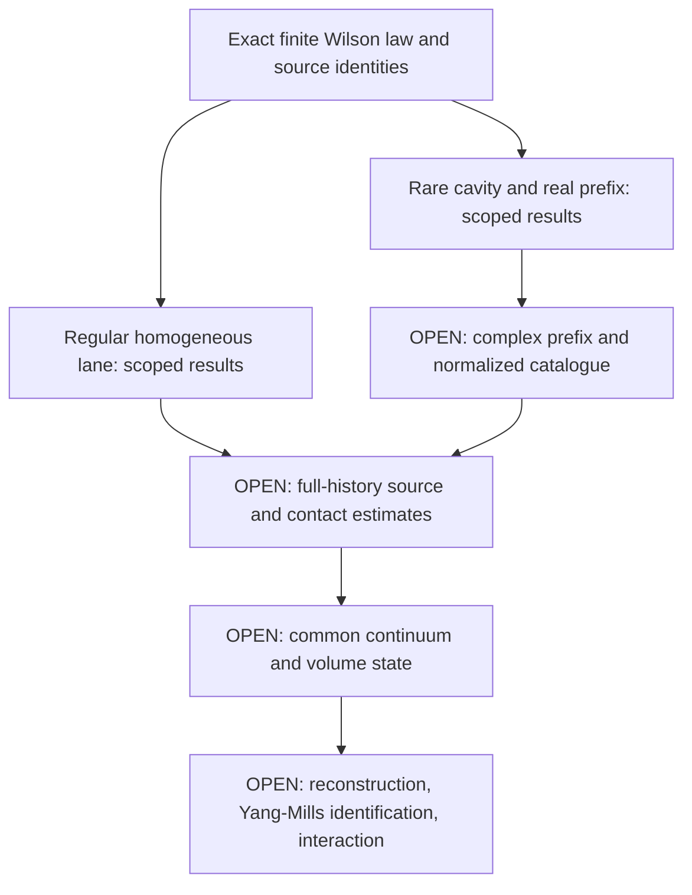

# YM4: research map and collaborator entry point

**Status on 24 October 2026: the continuum existence proof is unfinished.**

The target is one **nontrivial, interacting, local four-dimensional SU(2) Yang–Mills theory on R⁴ at positive renormalized coupling**. Mass gap, uniqueness, universality, and extension to all compact gauge groups are outside this snapshot's stated target.

This repository organizes the supplied YM4 handoff into a readable proof map. The work has exact finite identities and internally reviewed local results, followed by explicit missing interfaces. An internal audit marked “PASS” is a scoped research review; it is not independent certification of the existence theorem.

## Start here

1. Read the table below, then the [proof-status ledger](docs/PROOF-STATUS.md).
2. Pick a task from the [open problems and acceptance criteria](docs/OPEN-PROBLEMS.md).
3. Read the [incomplete manuscript](paper/YM4-incomplete-proof.pdf), or its [editable source](paper/manuscript_core.tex), alongside the linked producer notes and audits.
4. Use the [reading guide](docs/READING-GUIDE.md) and [evidence index](catalog/README.md) when a dependency sends you deeper into the archive.

## What is established, and at what scope?

“Available” below means available at the stated hypotheses in the supplied research record. These are ingredients, not completed global milestones.

| Ingredient | Recorded status | Boundary that matters |
| --- | --- | --- |
| Exact normalized source transport, covariance emissions, and logarithmic contacts | Exact finite identities | Original cuts, normalizers, retained variables, and final covariance remain in the law. |
| Homogeneous signed Gaussian drift and terminal-coupling tuning | Internally reviewed local results | Finite homogeneous horizons; no compatible continuum family or full mixed-history law yet. |
| Coherent regular Wilson source core | Internally reviewed registration using inherited modules | Its special cancellation belongs to that complete coherent family, not arbitrary masks or rare sources. |
| Original rare cavity mark and first native source column | Internally reviewed finite results | Fixed cavity, original denominator, shrinking complex source domain, and complete independent field/current tests. |
| Real constrained-minimum tower and real whole-product continuation | Internally reviewed latest addenda | Real, source-zero maps under stated smallness/admission conditions; original history masks may still vanish. |
| Rare-source stability and finite-delay transport | Conditional results | Useful conclusions only after native domains, normalized reads, carrier costs, and the root count have been supplied. |
| Complete complex prefix, full-history estimates, continuum state, reconstruction, and interaction | **Open** | These are required steps of the requested construction. |

Exact evidence links, dependencies, and exceptions are in the [ledger](docs/PROOF-STATUS.md). No percentage of a completed proof is assigned.

## The next mathematical bottleneck

The real estimates explain how the original cavity read can shrink over a logarithmic number of ordinary steps. The missing bridge is a **complete complex source extension through that prefix**. It must track the literal ordinary-average versus background-relative-Q endpoint return, the selected independent current after localization, every reconstructed domain test, and the original normalized law.

There is **no completed producer or scoped audit for the proposed complex common-frame prefix theorem**. A restricted second-step image lemma is available, but it does not close this gate. Begin with [G1a: endpoint and coarse-frame return](docs/OPEN-PROBLEMS.md#g1a--exact-endpoint-return-and-coarse-frame-record) and the preserved [frontier report](guide/frontier.txt).

Closing this bridge would still leave full-history source closure, observable/contact estimates, one common continuum and infinite-volume state, the required field-theory properties, Yang–Mills identification, and an interaction witness.

## How to help

Choose one [work package](docs/OPEN-PROBLEMS.md), state the exact claim and domain, and submit a proof, counterexample, or precise dependency correction using the [contribution guide](CONTRIBUTING.md). The best first contribution may be a narrow interface lemma or an audit of one import. Keep conditional estimates conditional until their native hypotheses have been verified.

For orientation: [notation](docs/NOTATION.md) · [primary literature](docs/SOURCES.md) · [failed shortcuts and scope corrections](docs/CORRECTIONS.md).

## What is in this repository?

The repository contains the current delivered research notes, the five latest producer/audit pairs, selected inherited dependencies, the incomplete manuscript, and a catalogue mapping the full supplied archive to the public evidence selection. Duplicate working copies are resolved through the catalogue. The original 6,000-file ZIP remains the preservation source; this repository is a curated research edition, not a claim to reproduce every archived file.

See [archive provenance and coverage](docs/ARCHIVE.md). Raw conversation exports, local operational files, and third-party paper caches are not part of this edition. The new navigation records the 24 October snapshot; historical instructions and status labels inside evidence files are source material, not current contributor instructions.
