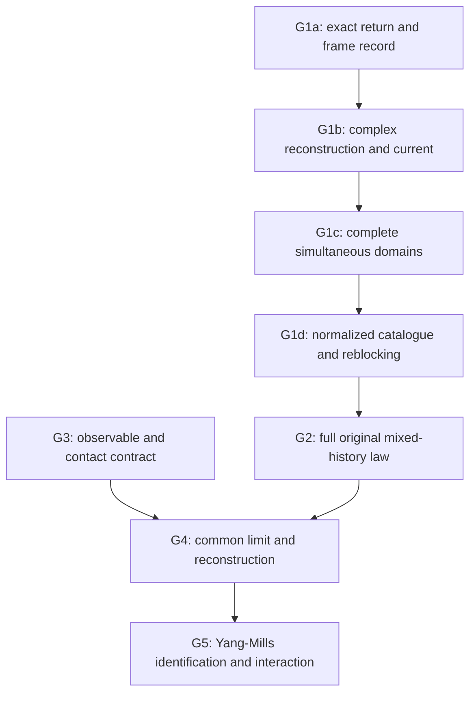

# Open problems and collaborator work packages

**Snapshot: 24 October 2026. The existence proof is unfinished.** The target is a nontrivial, interacting local four-dimensional SU(2) Yang–Mills theory on R⁴ at positive renormalized coupling. Mass gap, uniqueness, universality, and extension to all compact gauge groups are not additional requirements of this program.

This map turns the [current status](../guide/CURRENT-STATUS.txt) and [unfinished frontier](../guide/frontier.txt) into bounded tasks. It proposes definitions of done; it does not add a theorem or certify the inherited proof corpus. Each producer's precise hypotheses and scoped audit govern its use. An internal **PASS** is a local review, not peer review or certification of every dependency.

## Where to start

The immediate gap is **G1: admit the original rare cavity source through a finite logarithmic delay in the complete complex source domains, with a usable normalized catalogue**. The real-prefix results provide a mechanism worth investigating, but no completed joint complex-prefix producer or scoped audit was saved.

The proposed common-frame route breaks into G1a–G1d below. An alternative route is welcome if it establishes the same admission and normalized-source guarantees while preserving the original law. A counterexample to a precise proposed interface would also be useful; no counterexample to the existence of this bridge has been established.

The arrows show proof dependencies, not a requirement to work serially. Domain checklists, normalization criteria, complementary-sector analysis, and the observable/reconstruction contract can be developed in parallel. They cannot be marked established by assuming their missing inputs.

## Requirements shared by all G1 tasks

- Keep the **original real noise variables**, cuts, normalizers, scalar/coarea/current factors, branch weights, physical calibration, and microscopic source count. A complex gauge may conjugate evaluated outputs with proved norm losses; it does not authorize rotating real noise while declaring its integration law unchanged.
- Keep raw first and mixed source coefficients, scalar emissions, connected contacts, and the final covariance. Do not divide the rare source by its event probability.
- Keep the **selected independent current** after localization. A fresh physical-current calculation is generally a different analytic continuation.
- Check the whole source image: all determining sets, collars, gauges, near/far terms, and source **s**-contours. The action-only **t_D** circle is a separate object.
- Distinguish existence of auxiliary maps from properties of the original law. The real whole-product theorem permits original history masks to vanish.
- Report a complete statement, dependencies, domains, constants and uniformities, physical agreement, and a scoped audit. If a premise is only conditional, leave it visible.

The [notation bridge](../guide/NOTATION-AND-CONVENTIONS.txt) is useful throughout. In particular, `x_j` can mean inverse coupling in trajectory notes and original noise in prefix notes; local definitions prevail.

## G1a — Exact endpoint return and coarse-frame record

**Open claim.** Relate the literal recursive ordinary group-average endpoint to the background-relative Q reconstruction after its relative axial and Landau returns, carrying the necessary coarse-frame information through subsequent source weakenings.

**Why this is first.** B98's return normalization is an averaged condition such as `(R₀u)^j = 1`; it does not automatically mean that `u` equals one at every ordinary coarse center. The reviewed real tower gives gauge equivalence and real norm estimates, without proving equality of the ordinary averages of the returned complex representative with the actual `V_j`. Individual charts around real centers do not automatically form a joint family when the centers also vary complexly.

**Definition of done.** Give the explicit endpoint maps and identities, gauges, centers, domains, and frame record at every grade. Prove agreement with the original numerator on admitted physical histories. A new off-graph source extension is allowed, but its unmarked factors and normalizers must stay in the same declared continuation or be rebuilt with an exact physical identity and their own verified bounds. Do not assume `U_j(M^j U_t) = U_t` off the physical graph.

**First reading:** [frontier §§2–3](../guide/frontier.txt), [real minimum tower](../evidence/current/work/original_cavity_real_prefix_minimum_tower_20261024.txt), [its audit](../evidence/current/work/original_cavity_real_prefix_minimum_tower_audit_20261024.txt).

**Primary checks:** B98 (104)–(108), (130)–(135), Proposition 4; B109 printed p.265; B99 gauge paper printed pp.88–89, (1.70)–(1.74). The frontier supplies the archive locators. B98's cited complex relative-field estimate uses a regular **real** background; a varying complex background needs additional bounds.

## G1b — Joint complex reconstruction and selected current

**Depends on:** G1a's representative record and the actual native response maps.

**Open claim.** Construct one jointly holomorphic field/current family through the finite prefix using each original real noise variable in its literal native map. Control the complex return products without a generic multiplicative loss `C^t`.

The proposed fine source-image target is

`C [L^(-2t) α_core + Σ_(j<t) L^(-2j) δ_j]`.

This is a target for the complex theorem, not an established complex estimate.

**Definition of done.** Retain the full private-pivot map `B′_j = g_j C_j x_j − h_j D̃_j(g_j C_j x_j)`, including solved pivots. Carry the selected current `θ³J + ΔA − P₁A + F₁(U,A)`; its zero-noise slot is `θ³J`, not `J`. Bound the field, covariant derivative, P₁ and covariant-Laplacian response slots, all near/far terms, and actual gauge-return losses on the required joint contours. State reserves and prove the claimed uniformity in prefix length and volume, with any dependence on fixed `L` explicit.

**First reading:** [frontier §§2, 4–5](../guide/frontier.txt), [real whole-product continuation](../evidence/current/work/original_cavity_real_prefix_whole_product_20261024.txt), [its audit](../evidence/current/work/original_cavity_real_prefix_whole_product_audit_20261024.txt).

**Primary checks:** B109 printed pp.272–273, (3.10)–(3.17); B116 printed pp.2–6, (1.18)–(1.21); CMP102 printed pp.305–309, (170)–(190), Proposition 9. Existing upward moving-average bounds do not automatically prove the required downward noisy reconstruction.

## G1c — Simultaneous complete pair-domain admission

**Depends on:** G1a–G1b or an alternative theorem providing their required maps.

**Open claim.** Every required source-localizer image belongs simultaneously to its complete native old/current pair domain, across the original noise product and the required finite delay `t = O(log(g₀⁻¹))`.

**Definition of done.** For each primitive and descendant, specify and check its complete determining tower, collars/insets, gauge representative, compact real reference, relative complex C¹ field, independent current, and reconstructed tests (iv). Check all source s-contours and response norms together. Retain the actual current allowance when it is smaller than the curvature allowance, and verify the fixed `A₀/A₁` cutoff hierarchy and real margins.

A fixed source-radius contraction at every date does not supply the required logarithmic delay. The current restricted second-step lemma does not establish a finished second connected catalogue. Its variational constant `B₃` depends on `L`; increasing `L` alone does not show that an apparent `L²` gain pays that loss. A successful result needs genuine image enlargement or a coherent complete-prefix inclusion.

**First reading:** [first native pair column](../evidence/current/outputs/YM4-pinned-cavity-native-pair-first-column-20261024.txt) and [audit](../evidence/current/outputs/YM4-pinned-cavity-native-pair-first-column-audit-20261024.txt); [restricted second-step image](../evidence/current/work/pinned_cavity_second_ordinary_pair_image_20261024.txt) and [audit](../evidence/current/work/pinned_cavity_second_ordinary_pair_image_root_audit_20261024.txt).

**Primary checks:** B109 printed pp.262–263, (i)–(iv), (1.15)–(1.17). Curvature/current recurrences alone do not check this complete domain.

## G1d — Normalized catalogue, connected cancellation and reblocking

**Depends on:** actual admitted images from G1c. Norm criteria can be investigated earlier.

**Open claim.** Bound the normalized connected catalogue generated by the original cavity source through the finite delay, then register it in the later dated recurrence with the original microscopic source count.

**Definition of done.** Prove a suitable normalized complex estimate with the complete original cuts and denominator, through a registered zero-free/phase/Poincaré argument, protected complete-carrier expansion, or another valid mechanism. Count read-dependent tube shrink, inverse-margin prices, seed entropy, connected cancellation, and actual reblocking. Register the hypotheses of the finite analytic-transport and rare-source Volterra consumers for this particular generated family, with a scoped audit.

Real positivity alone does not bound normalized complex expectations. The fixed four-edge saddle controls its own unmarked denominator; it is not a theorem for all later denominators. Small amplitude does not repair an inadmissible argument.

For the finite budget `t ≤ C log x₀`, a finite `L^(4t)` census may fit within a once-paid `exp[C(log x₀)²]` loss, **after** the image/carrier hypotheses and sufficient logarithmic cutoff strength are verified. Subsequent arbitrary-age transport must pay `L^(4s)` through a proved scaling gain or another source estimate; rarity alone does not do so.

**First reading:** [normalized complex read cost](../evidence/current/work/normalized_complex_conditional_read_cost_20261024.txt) and [audit](../evidence/current/work/normalized_complex_conditional_read_cost_root_audit_20261024.txt); [finite admission transport](../evidence/current/outputs/YM4-analytic-mark-finite-admission-transport-20261024.txt) and [audit](../evidence/current/outputs/YM4-analytic-mark-finite-admission-transport-audit-20261024.txt); [rare-source Volterra stability](../evidence/current/outputs/YM4-rare-source-Volterra-stability-20261024.txt) and [audit](../evidence/current/outputs/YM4-rare-source-Volterra-stability-audit-20261024.txt).

The normalized-read note proves exact finite identities and conditional criteria. It does not register native uniform Poincaré/score assumptions or a fixed-radius polynomial norm for the native source class.

## G2 — Full original mixed-history source law

**Open claim.** Cover all necessary source sectors of the original measure, including prior-record failures, selector/event/patch complements, companions, scalar rows, contacts, and closing covariance.

**Definition of done.** Supply a complete exact decomposition with original masses and uniform bounds for all required sectors and contacts. Evolve sources with the actual conditional kernels and control the terminal covariance. A selected success sector cannot be assigned probability one. If a history reads the eliminated cavity interior, the exterior cavity identity does not justify replacing its marked numerator separately on that history. Local partition completion cancels internal moving boundaries only on its stated common fiber; prior-record and exterior complements remain.

**First reading:** [original-source rare complement](../evidence/current/outputs/YM4-original-source-rare-complement-20261024.txt) and [audit](../evidence/current/outputs/YM4-original-source-rare-complement-audit-20261024.txt); [manuscript](../paper/manuscript_core.tex), finite-law and hard-mask sections.

## G3 — Observable algebra, calibration, collisions and volume control

**Open claim.** Specify and justify the observable algebra and topology for the limiting theory, including contact prescriptions and local volume estimates.

**Definition of done.** State physical calibrations and test classes; prove joint estimates at the intended separation and collision scales, contact control, and volume-uniform estimates sufficient for the chosen compactness or convergence argument. The unchanged-calibration raw Wilson energy does not have the uniform L² bound that an earlier route would need. Separated, collision-flat, or suitably renormalized distributional observables are possible contracts to investigate; none is selected or justified by this map. A separated-covariance bound is not a coincident-point bound.

**First reading:** [Wilson variance and locality](../evidence/current/outputs/YM4-Wilson-variance-and-locality-20261023.txt) and [audit](../evidence/current/outputs/YM4-Wilson-variance-audit-20261023.txt); [manuscript](../paper/manuscript_core.tex), “The incomplete continuum architecture.”

## G4 — Common continuum/infinite-volume state and reconstruction

**Depends on:** uniform full-law estimates from G2 and a specified contract from G3.

**Open claim.** Construct a common continuum/infinite-volume state or compatible limiting correlation family, and establish its required reconstruction properties.

**Definition of done.** Give a controlled cutoff/volume procedure and compatibility or subsequence argument for the tuned family. Prove consistency, reflection positivity, continuous symmetry/covariance, regularity, locality, and the precise reconstruction hypotheses in the chosen observable and regulator scheme. Independently chosen finite-horizon tuned roots are not already a limiting family. Positivity of individual real conditional kernels does not alone prove reflection positivity of the limiting state.

**First reading:** [homogeneous signed drift and tuning](../evidence/current/outputs/YM4-native-signed-drift-and-homogeneous-tuning-20261024.txt) and [audit](../evidence/current/outputs/YM4-native-signed-drift-and-tuning-audit-20261024.txt); [current global status](../guide/CURRENT-STATUS.txt); [manuscript](../paper/manuscript_core.tex), final architecture.

## G5 — Yang–Mills identification, nontriviality and interaction

**Depends on:** the same limiting state from G4 and its observable algebra from G3.

**Open claims.** Identify the dynamics as the intended nonabelian Yang–Mills theory, show a nonzero physical observable or reflection norm, and establish genuine interaction.

**Definition of done.** State and prove a dynamical identification criterion. Give a nontriviality lower bound that survives complementary sectors and contacts. Supply an interaction criterion, with normalization and contact prescriptions, that excludes the relevant free or generalized-free alternatives in the identified algebra. A nonzero regular-core coefficient need not survive the full original law. A nonlinear composite of a free field can have nonzero higher cumulants; those alone are not an interaction proof. Two-point nontriviality alone is also insufficient.

**First reading:** [manuscript](../paper/manuscript_core.tex), final six-item architecture list; [current status](../guide/CURRENT-STATUS.txt).

## How to make a contribution reviewable

Choose one gate and name the exact claim you address. Supply its assumptions, complete domains and reads, original-law identity where relevant, estimates with uniformity claims, dependency and primary-page locators, and the remaining exclusions. Pair a proof note with a scoped audit; retain failed tests and counterexamples with the precise shortcut they exclude. A partial result should state which gate it advances and which acceptance conditions remain open.
